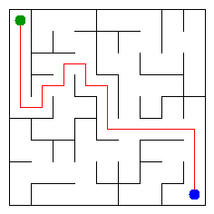

# Assignment 3. Maze Escape

Student ID:254042
Name:Balyasnyy Alisher
Group:SE-2510
Maze size (rows x columns):9 x 9

This file is the report. Fill it in as you go. How to start: `START_HERE.md`. The task: `docs/Assignment3.pdf`.

## Program output

The 13 lines your program prints on your data (`java -cp out Main`):

    Broken: 80
    Kept: 64
    Last broken wall: 130
    MST cost: 25037
    Heaviest broken wall: 846
    Path length: 20
    DFS visited: 50
    Dead ends: 26
    Zones: 81
    Largest zone: 1
    Is DAG: 1
    Flow stages: 14
    Fastest route cost: 20

My maze:

## Questions

Mission 0. What do find and union do, and what makes them fast in your code?
The find method returns the representative of the set containing an element. The union method
joins two different sets. Path compression and union by size make these operations efficient.

Mission 1. Why is Broken always R*C - 1, and Kept always (R-1)*(C-1)?
A maze with R rows and C columns has R × C cells. Breaking R × C − 1 walls connects all cells into a spanning tree, so Broken is R × C − 1. The remaining walls are (R − 1) × (C − 1), because the total number of internal walls is 2RC − R − C.

Mission 2. My MST cost from Kruskal and from Prim, and why they are equal:
Kruskal and Prim find a minimum spanning tree of the same connected, weighted maze graph. Their MST costs are equal because both algorithms find a minimum spanning tree, although they choose walls in different orders.

Mission 3. Why is there exactly one path between two cells? How did you avoid a stack overflow on a huge maze?
There is exactly one path between any two cells because the maze formed by the broken walls is a tree: it is connected and has no cycles. I used iterative DFS with an explicit stack instead of recursive calls to avoid a stack overflow on a large maze.

Mission 4. Why does the second pass of Kosaraju go on the reversed graph? Why do the slides have no cycle exactly when Zones equals the number of cells?
Kosaraju's algorithm uses the reversed graph in its second pass so that each search identifies one strongly connected component in the correct order. The slides have no cycle exactly when every strongly connected component contains one cell, so the number of zones equals the number of cells.

Mission 5. Why is it enough to go through the zones in the order of their numbers? What does this pass cost?
The zone graph is a DAG, and the zone numbers are assigned in topological order by Kosaraju's algorithm. Therefore, processing zones in that order lets us calculate route values from earlier zones to later ones using dynamic programming in O(V + E) time for the zone graph.
## AI use

I used ChatGPT as a learning assistant: it explained algorithms, helped me find errors, and reviewed my implementations for assignments 0–5. Thanks to these explanations, I gained a better understanding of the code.

## Timing (Mission 7)

Milliseconds, 5 runs each, from `java -cp out Bench`.

| maze | Kruskal | Prim |
|---|---------|------|
| 100 x 100 | 14      | 7    |
| 300 x 300 | 67      | 61   |
| 1000 x 1000 | 984     | 1600 |

The results show that both algorithms take more time as the maze gets larger. Kruskal is faster on the 1000 x 1000 maze in these measurements, while Prim is faster on the 100 x 100 maze. The measured times can vary between runs depending on the computer and system load.

## Complexity

n is the number of cells, m the number of walls (or slides). Fill in every algorithm you wrote.

| algorithm | time                     | space | assumptions |
|---|--------------------------|---|---|
| DSU find and union | Amortized O(α(n)) per operation | O(n)| Path compression and union by size|
| Kruskal | O(m log m)               |O(n + m)|Sorting all walls dominates; DSU operations are nearly constant amortized time |
| Prim | O(m logm)                |O(n + m) | Adjacency lists and a priority queue; duplicate queue entries may occur|
| DFS |O(n + m)                  |O(n)|Iterative DFS with adjacency lists and an explicit stack |
| Kosaraju |O(n + m)                  |O(n + m) |Two iterative DFS passes; reverse graph is stored |
| Route in the zone graph |      O(Vz + Ez)                    |O(Vz + Ez)|Dynamic programming over a DAG in topological order; Vz is the number of zones and Ez is the number of zone edges |

## Before you submit

- data/walls.txt, data/slides.txt and output/maze.png are in the repository.
- `java tools/Check.java` shows all examples right.
- This README is filled in, the program output and the section AI use included.
- The work is pushed to main (at least one commit per mission) and the repository is public.
- The link is attached in Moodle.
